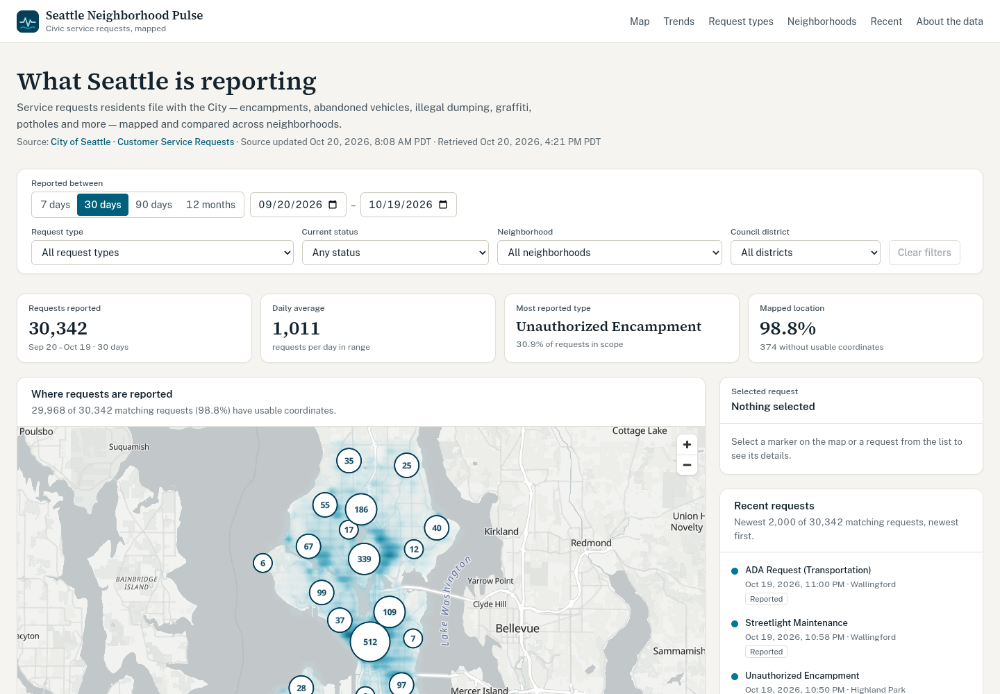
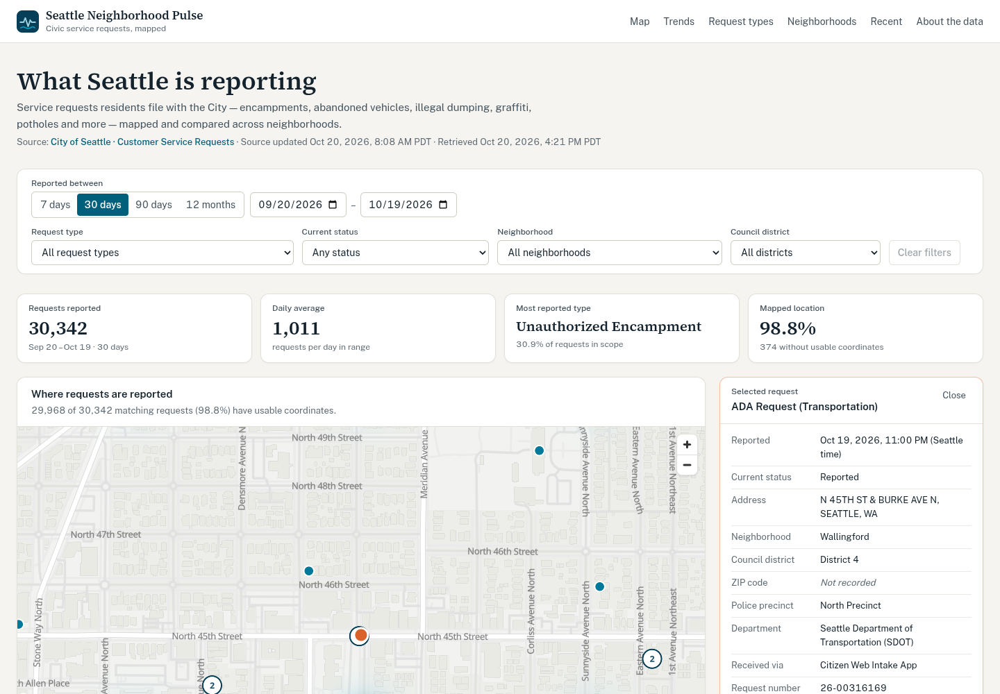

# Seattle Neighborhood Pulse

[](https://github.com/joshduplaa/seattle-neighborhood-pulse/actions/workflows/ci.yml)

An interactive civic intelligence dashboard for exploring what Seattle residents report to the City: where requests are concentrated, which neighborhoods report the most, what kinds of issues dominate, and how volume changes over time. Every number comes live from the City of Seattle's open data.

This is an exercise in agentic development using Claude Code.



## Features

- **Map of Seattle.** Three backgrounds you can switch between:
  - **Neighborhoods** (default): the City's 53 Community Reporting Areas, shaded in five quantile classes by request count or by requests per 1,000 residents. Hover an area for its count, rate and population; click it to filter.
  - **Density:** a heatmap of *every* matching geolocated request, aggregated server-side.
  - **Off.**

  Clustered markers on top show the newest 2,000 matching requests. Click a cluster to zoom in, or a marker to see its details. The legend states each layer's scope.
- **Filters:** date range (presets or custom), request type, current status, neighborhood (Community Reporting Area) and council district. Filters live in the URL, so any view can be shared. Every filter updates the map, metrics, charts and list together.
- **Summary metrics:** total requests, daily average, most reported type, and the share with usable coordinates.
- **Trends:** requests per day, week (Mon–Sun) or month, chosen from the range length. Days with no requests are zero-filled, and buckets cut short by the range are drawn dashed and labelled.
- **Breakdowns:** request types, current status, and an area comparison by neighborhood or council district. Neighborhoods can be compared by raw count or **per 1,000 residents** (2020 Census). Areas with fewer than 5,000 residents are listed separately rather than ranked, because their rates aren't comparable. Each bar is a keyboard-accessible button that toggles that filter.

  The count / per-capita choice drives the map shading too.
- **Recent requests:** newest first and paged. Selecting one flies the map to it and opens its detail card. Requests without coordinates are listed and flagged, never placed on the map.
- **Loading, empty, partial and error states** throughout. If a refresh fails, the last good results stay visible with a retry button.



## Quick start

Requires **Node.js 22.12+** and npm. Node 24 LTS is recommended and pinned in `.nvmrc` (`nvm use`).

```bash
git clone https://github.com/joshduplaa/seattle-neighborhood-pulse.git
cd seattle-neighborhood-pulse
npm ci
npm run dev        # http://localhost:3000
```

No API key or database is needed. Optionally, copy `.env.example` to `.env.local` and set `SOCRATA_APP_TOKEN` to raise Socrata's throttling limits.

| Command | What it does |
| --- | --- |
| `npm run dev` | Development server (copies the MapLibre worker first) |
| `npm run build` / `npm start` | Production build and server |
| `npm test` | Unit and component tests (Vitest + React Testing Library) |
| `npm run typecheck` | `tsc --noEmit` (strict, `noUncheckedIndexedAccess`) |
| `npm run lint` | ESLint (Next.js core-web-vitals + TypeScript rules) |
| `npm run check` | Typecheck, lint and test together |

## Data source

| | |
| --- | --- |
| Dataset | [Customer Service Requests](https://data.seattle.gov/d/5ngg-rpne), City of Seattle (public domain) |
| Dataset ID | `5ngg-rpne` |
| API | Socrata SODA 2 / SoQL: `https://data.seattle.gov/resource/5ngg-rpne.json` ([API docs](https://dev.socrata.com/foundry/data.seattle.gov/5ngg-rpne)) |
| Scope | Requests submitted through the Find It, Fix It app, the Customer Service Request portal, phone, email and other channels, for request types that are or were offered to the public |
| Size and freshness | ~2.53 million rows, Jan 2013 → present; refreshed once a day (as of 2026-10-20) |

All dataset constants live in [`src/lib/socrata/config.ts`](src/lib/socrata/config.ts).

### Neighborhood boundaries and population

| | |
| --- | --- |
| Dataset | [Community Reporting Areas (2020) – Redistricting Data 1990–2020](https://data.seattle.gov/d/7mx9-c62n), City of Seattle |
| Hosted at | Seattle GeoData (ArcGIS): `services.arcgis.com/ZOyb2t4B0UYuYNYH/arcgis/rest/services/CRA_90_20_PL/FeatureServer/0` |
| Used | 53 area polygons (simplified to ~10 m) and `F2020_PL_data_TOT_POP`, the 2020 Census P.L. 94-171 total population (sums to 737,015, Seattle's 2020 count) |
| Stored as | Static files in [`src/data/`](src/data), regenerated with `node scripts/fetch-cra-data.mjs` |

All 53 area names match the requests dataset's `community_reporting_area` values exactly, ignoring case (verified on 2026-10-20). Boundaries and 2020 population change rarely, so they ship with the app instead of being fetched at runtime.

### What reconnaissance found (verified against the live API on 2026-10-20)

- **Fields used:** `servicerequestnumber`, `webintakeservicerequests` (request type), `departmentname`, `createddate`, `methodreceivedname`, `servicerequeststatusname`, `location` (address), `latitude`/`longitude`, `latitude_longitude` (point), `zipcode`, `councildistrict`, `policeprecinct` and `community_reporting_area`.
- **Dates:** `createddate` is a *floating* timestamp (no UTC offset) in Seattle local time. The app treats it as a local calendar date and never shifts it through a timezone.
- **No resolution timestamp.** The dataset has only the current status, so the app does **not** compute or imply time-to-close. (A separate tracking dataset, `43nw-pkdq`, logs status updates, but only for five request types. It was not used.)
- **Statuses** (10 values): `Closed`, `Open`, `Reported`, `New`, `Transferred to Other Dept`, `Duplicate (Closed)`, `Duplicate (Open)`, `Closed as Duplicate`, `Closed -Incomplete Information`, `Canceled`. They are shown verbatim, not regrouped.
- **Geography:** 53 Community Reporting Areas (the City's neighborhood-scale planning unit), 7 council districts, ZIP codes and police precincts. These are different boundaries, so the app labels each comparison with its unit and never treats one as another.
- **Data quality, last 90 days:** about 1.2% of rows lack coordinates and about 1.6% lack a Community Reporting Area. Across all years, 77,909 rows lack coordinates. No coordinates were found outside Seattle, but values outside a Seattle bounding box are still treated as invalid rather than plotted.
- **API behaviour:** SODA 2 returns every value as a string and omits null fields; group-by omits empty groups; the default page is 1,000 rows. Without an app token, requests are throttled (HTTP 429 is possible). The WAF returns HTTP 403 for some SQL-like input even when it is correctly escaped.

## Architecture

```
Browser (client components)                Next.js server                       Seattle Open Data
──────────────────────────                 ──────────────────                   ─────────────────
useFilterState ── URL search params
useDashboardData ── GET /api/dashboard ──▶ route.ts
                                           ├─ parseFilters (validate/clamp)
                                           └─ getDashboardDataCached ── TTL cache (15 min, in-flight de-dupe)
                                               └─ getDashboardData ── 8 SoQL queries in parallel ──▶ /resource/5ngg-rpne.json
                                                  ├─ normalize (zod)
                                                  └─ aggregate (zero-fill, buckets, totals)
```

```
src/
  app/
    page.tsx, layout.tsx        page shell, header, nav, footer
    api/dashboard/route.ts      the only server endpoint: validation, error mapping, gzip
  lib/
    socrata/config.ts           dataset IDs, URLs, field names, limits
    population.ts               2020 population, per-1,000 rates, quantile classes
    socrata/soql.ts             SoQL query builders (escaping, half-open date range)
    socrata/client.ts           fetch with timeout, retries, typed SocrataError
    socrata/normalize.ts        zod validation and normalization of raw rows
    aggregate.ts                time-series bucketing, totals, top-N folding
    dashboard.ts                assembles one coherent DashboardData response
    dashboard-cache.ts, cache.ts  in-process TTL cache
    filters.ts, dates.ts, format.ts, types.ts
  components/
    map/                        MapLibre map (client-only), layers, legend, overlays
    charts/                     TrendChart (Recharts), RankedBars (semantic HTML)
    dashboard/                  filters, metrics, panels, recent list, detail, provenance
  hooks/                        URL filter state, data fetching with abort
  data/                         CRA boundaries + 2020 population (generated by scripts/fetch-cra-data.mjs)
```

### Key decisions

- **Aggregate on the server, never in the browser.** Each filter change triggers eight SoQL queries server-side:
  - four facet counts (type, status, area, district), each applying every filter *except its own*, so it can show the selected value among the alternatives and give the dropdown counts;
  - daily counts, rolled up into days, weeks or months;
  - a `snap_to_grid` density grid of about 550 m cells;
  - the newest 2,000 matching rows;
  - the dataset's newest timestamp.

  The browser receives about 76 KB gzipped, never millions of rows.
- **Explicit data scopes.** Totals, charts, breakdowns and the density layer cover *all* matching requests. Markers and the recent list are a labelled sample of the newest 2,000. The total is derived from the type facet, and tests check that the facets and the time series sum to the same number.
- **One filter model everywhere.** `parseFilters` normalizes the URL on the client and the query on the server identically. Invalid input is corrected and reported, never silently trusted. SoQL literals are escaped.
- **Caching.** The source updates once a day, so results are cached in-process for 15 minutes, keyed by the normalized filters, and concurrent identical requests share one upstream call. Failures are never cached. Responses also carry `Cache-Control: s-maxage=300, stale-while-revalidate=600` for CDNs.
  - Next 16's `'use cache'` was tried and dropped: errors thrown inside it are serialized and lose their class, which broke the typed error mapping (timeout → 504, rate limit → 503, and so on).
- **Presets end yesterday.** The City publishes once a day, so "today" is almost always incomplete and would look like a sudden drop. Custom ranges can include today, and the chart then warns that the last day may be incomplete.
- **Ranked bars are HTML, not SVG.** Category, status and area breakdowns double as filter controls, so they are real buttons with `aria-pressed` and wrap long Seattle place names. Recharts draws the time series, where a crosshair and tooltip matter.
- **Map.** MapLibre GL 6 with the key-less [OpenFreeMap](https://openfreemap.org) Positron basemap (OpenStreetMap data). MapLibre 6 loads its web worker relative to its own module, which bundlers relocate, so `scripts/copy-maplibre-worker.mjs` copies the worker into `public/vendor/` before `dev` and `build`, and the app calls `setWorkerUrl()`.
- **Visual system.** A neutral fog canvas and slate ink, one data hue (Puget Sound teal `#00789a`), a one-hue sequential ramp for density, and ferry orange reserved for the selected request. The data colors were checked for colour-vision-deficiency separation and contrast.

## Verification

- **CI:** [GitHub Actions](.github/workflows/ci.yml) runs `npm ci`, `npm run check` and `npm run build` on Node 24 for every pull request and every push to `main`.
- `npm run typecheck`, `npm run lint`, `npm test` (66 tests) and `npm run build` all pass.
- Tests cover date maths (DST, leap years, Seattle "today"), filter parsing and clamping, SoQL building and escaping, normalization against **real captured API responses** (`src/lib/__fixtures__/`), malformed input, time-series bucketing and partial buckets, cache behaviour, HTTP client retry and error classification, the API route's error mapping and gzip, and key components.
- Headless Chrome was used to check the main flows (select from list, filter via bars, area fit, presets), the empty and error states, layout at 390 px, 820 px, 1280 px and 1440 px (no horizontal overflow), and axe-core WCAG 2.1 AA (0 violations).

## Limitations

- **Counts are reports, not problems.** Several residents may report one issue; the duplicate statuses capture only some of these.
- **Per-capita rates are approximate.** They use 2020 Census residents. Requests also come from workers and visitors, so commercial areas still rank high, and areas under 5,000 residents aren't ranked. Council districts have no population data here, so their comparison is counts only.
- **No resolution times.** The dataset has no closed date, and status is current status only.
- **Markers are a sample** (newest 2,000 matching requests). The density layer and every count use the full data.
- **Boundaries are simplified** to about 10 m for size, so edges are approximate at street level.
- **Freshness depends on the City.** The source updates about once a day. "Source updated" is the API's `Last-Modified` header.
- **The cache is per-instance memory.** In serverless deployments each instance warms its own cache.
- **The third-party basemap style** logs a few harmless MapLibre filter warnings in the console.

## Deployment

It's a standard Next.js app with no database or secrets.

- **Vercel:** import the repository; the defaults work. Optionally set `SOCRATA_APP_TOKEN`.
- **Any Node host:** `npm ci && npm run build && npm start` (set `PORT` as needed). The `prebuild` script copies the MapLibre worker, so always build with `npm run build`, not `next build` directly.
- Outbound HTTPS to `data.seattle.gov` (server) and `tiles.openfreemap.org` (browser) must be allowed.

Data: City of Seattle, Customer Service Requests (public domain). Basemap © OpenStreetMap contributors, OpenFreeMap. This is an independent project, not affiliated with the City of Seattle.
